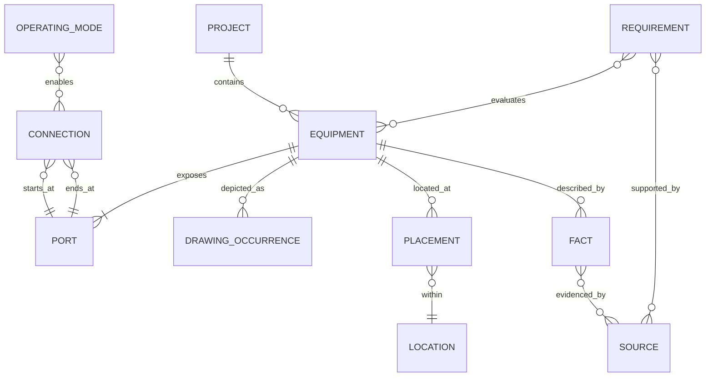

# Renewable engineering asset ontology 1.1

Researched 2026-11-06. This vocabulary covers reusable PV/BESS engineering assets, with extension points for microgrids, generator backup, transformers and MV interconnection. It defines information needed for later design, not a project scenario or a numerical sizing result. The machine contract is `assets/ontology/domain.schema.json`; symbol realizations are in `assets/catalog.json`. Use the retrieval index to load only the needed domain.

An equipment item is one real asset. A QET element is a drawing occurrence. A placement is its physical position. Schematic coordinates only control readability. A requirement is a question resolved by evidence; a note is text.

## Entities

| Class | Meaning and fields | Output |
|---|---|---|
| Project | ID, title, site/APN, scope, revision, issue stage, team | Title block and issue register |
| JurisdictionBasis | building/fire AHJs, utility, occupancy, permit date, editions/amendments | Cover/code-basis sheet |
| Source | primary URL/file, issuer, revision/date, access date, page/sheet/section, rights | Evidence index |
| Equipment | ID/tag, class, existing/new/remove/relocate, maker/model, location | Shared SLD/plan/schedule identity |
| Port | local ID, domain, role, voltage basis | Actual native terminal |
| Connection | ID, endpoints, domain, conductor/raceway facts, protection reference | Native conductor and circuit schedule |
| Fact | subject, parameter, value or null, unit, evidence status/source | Rating annotation and facts register |
| Location | indoor/outdoor/roof/garage/room/yard/utility, occupancy/context | Location and exposure context |
| Placement | asset, physical x/y, footprint, rotation, units | Equipment location plan |
| SpatialFeature | building, property boundary, opening, road, fire access, egress, roof pathway | Plan geometry |
| Clearance | subject/face/target, required/provided distance, evidence | Dimension/keep-clear area |
| ControlFunction | sensor, controller, controlled device, setpoint, failure response | Controls/sequence |
| OperatingMode | state, switching positions, sources, enabled circuits | Mode-specific topology |
| Requirement | applicability, rule/edition, evidence, reviewer, status | Compliance register |
| Calculation | method, inputs, units, results/limits, reviewer | Calculation reference |
| DrawingOccurrence | asset, sheet, symbol, schematic x/y, rotation | One of multiple views of the same asset |
| Review | discipline, reviewer, date, scope/disposition | Review/release record |

The schema exposes reusable definitions for these domains. Instantiation is deferred until an actual project is requested. Future calculation records carry inputs, methods, source/edition references, units, capacity basis, assumptions and review status; this ontology does not compute them.

## Separate meanings of state

| Qualified concept | Type | Example vocabulary | Must never stand for |
|---|---|---|---|
| `jurisdiction.subdivision_code` | geographic/legal jurisdiction | `US-CA`, `US-NY` | electrical operating condition |
| `operating.mode` | system operating mode | grid-parallel, islanded, transition, shutdown | California or another US state |
| `component.condition` | asset availability/health | available, degraded, failed, maintenance | geographic location or SOC |
| `switch.position` | device contact position | open, closed, transitioning, unknown | availability or jurisdiction |
| `battery.soc_fraction` | measured/calculated quantity | bounded fraction with time/basis/source | system mode or evidence approval |
| `review.status` | evidence/workflow disposition | open, needs-review, pass, fail, not-applicable | operating mode |

The ambiguous property name `state` is forbidden in the typed contract. A coastal environment is an exposure condition, not a US subdivision. Changing jurisdiction changes the applicable rule profile; changing operating mode changes active sources, isolation, controls and loads.

## Constraint domains

Physical constraints cover mounting method, substrate/load path, orientation, attachment, weight, servicing envelope, location restrictions, indoor/outdoor/roof setting, measured separation/exposure, flood/elevation, seismic/wind and access/egress. Environmental constraints cover salt spray/coastal exposure, corrosion category and mechanism, humidity/condensation, ingress, temperature, altitude, UV, pollution and required materials/coatings/maintenance. NEMA/IP descriptors and manufacturer environmental qualifications are distinct evidence fields; one does not universally substitute for the other.

Electrical constraints cover AC/DC, rated/range voltage, L-L/L-N basis, topology (including wye/delta), phases, wires/neutral, frequency, grounding, port compatibility, continuous/short-time current, SCCR/interrupting rating, fault duty and device settings. A `480 V` requirement cannot establish `480Y/277 V`, neutral availability or grounding arrangement on its own. A transformer changes voltage compatibility but adds its own ratings, grounding, fault and protection requirements.

Resilience requirements cover served-load boundary/profile, autonomy duration, outage start/window, allowed unserved energy, transfer interruption, initial/ending SOC, available sources, renewable-resource basis, failure cases, common-cause dependencies, black start, control/auxiliary supply, fuel/refueling and maintenance. `N+2` is a redundancy claim requiring a definition of N and the functions/units/capacities that survive specified failures. Three named source types alone do not prove N+2. Model the mains, BESS and generator roles/fallback transitions without presuming their adequacy.

Calculation requirements distinguish energy-code minimums, resilience energy/power, inverter apparent/transient power, load/demand, conductor/raceway/protection, fire/structural constraints and product selection. Title 24 is a building/project compliance context, not a battery marketing attribute. Store Part 6 applicability/path, building type/climate zone, adopted edition/errata, required inputs, JA12/equipment verification as applicable, forms and responsible review separately from autonomy. The final equipment selection must satisfy all applicable constraints after calculations are authorized.

## Compliance truth layer (1.2)

Constant knowledge sits apart from project facts. `STANDARD -> EDITION -> CLAUSE -> FORMULA/CONSTANT/CODE_TABLE` is append-only and versioned by edition; `CLAUSE_LINEAGE` records renumbering (NEC 2017 705.60 to 2020 705.28). A project selects editions (`PROJECT_EDITION`); a `REQUIREMENT` may cite only a clause in that basis; a `CALCULATION` pins one formula row and its inputs. Ratings (`FACT`) change with equipment selection; truth rows change only by a new edition. Every seeded locator and constant is `needs-verification` until a named reviewer checks the adopted text. See [compliance truth](compliance-truth.md).

## Equipment taxonomy

| Family | Classes | Parameters to obtain |
|---|---|---|
| Utility/service | utility, meter, service disconnect, switchboard/bus, transformer | voltage/phases/wires, bus/main A, available fault current, grounding; transformer kVA/impedance/vector group |
| Protection/isolation | breaker, fuse/fused switch, disconnect, relay, transfer/isolation | poles, frame/trip, interrupting rating, SCCR, settings, lockability, approved use |
| PV | array/string, combiner, RSD, PV inverter, AC combiner | module count/STC W/Voc/Isc/temp coefficients, string topology, DC limits, AC current, shutdown boundary |
| Storage | rack/cabinet/container, BMS, DC protection, converter | chemistry, gross/usable kWh, voltage range, charge/discharge kW/kVA/A, dimensions/weight, listing scope |
| Control | power control system, EMS, microgrid controller, CT/PT, E-stop | sensing/polarity, controlled device, setpoint, failure state, approved configuration |
| Loads/auxiliary | load/critical-load panel, HVAC, alarm/suppression, UPS | demand, motor starting, runtime, auxiliary/control supplies |
| Grounding | electrode, GEC, EGC, bonding jumper, neutral bond | conductor function, separately derived status, neutral switching/bond location |
| Site | footprint, pad, fence/gate, bollard, opening, egress/fire lane, roof path | measured geometry/elevation, access, utilities, mounting/exposure/setbacks |

PCS is ambiguous: `power_conversion_system` is the bidirectional converter; `power_control_system` limits current/export. One product may implement both, but model the functions and evidence separately.

## Relations and invariants

- `hasPort(Equipment, Port)`: unique within equipment; domains AC, DC, PE, control, sense. An AC single-line port can represent a multiphase circuit; it does not establish conductor count.
- `connects(Connection, Port, Port)`: real, distinct endpoints with matching domains. State phases/neutral/EGC in the schedule. Crossing strokes do not establish connectivity.
- `protectedBy(Connection, Equipment)`: actual protective device and position; proximity of a glyph proves nothing.
- `depictedAs(Equipment, DrawingOccurrence)`: schematic coordinates are NTS; physical positions have declared origin/units/north. Multiple views never duplicate a physical asset.
- `locatedIn(Equipment, Location)`: installed items have location evidence; all sheets agree on tags/quantities.
- `substantiatedBy(Fact/Requirement, Source)`: revision and page/sheet/section matter. Distinguish manufacturer data, listing, survey, calculation and historical example.
- `governedBy(Project, JurisdictionBasis)`: version the basis; record amendments and utility rules. Historical code notes never become current defaults.
- `controls(ControlFunction, Equipment/Port)`: explicit signal, control supply, target, setpoint/failure response. Never merge control and power nets.
- `enables(OperatingMode, Connection)`: evaluate intended states. Island operation requires verified utility isolation and suitable grid-forming source. Grid-following anti-islanding alone establishes no backup design.
- `requiresEvidence(Requirement, Source/Calculation/Review)`: statuses open, needs-review, pass, fail, not-applicable. Pass needs evidence and reviewer; not-applicable needs reason. Empty checks do not prove compliance.

## Quantities and uncertainty

Explicit units include V, A, kW, kVA, kWh, Hz, ohm, percent, ft, in, mm, kg and lb. Distinguish kW/kWh, kA interrupting/A trip, AC/PV DC-STC, usable/gross energy, L-L/L-N, AC rms/DC.

Facts are `unknown`, `assumed`, `provided`, `verified`, or `engineer-reviewed`. Provided is not verified. Null means unknown; zero is a real zero. Preserve OCR/extraction uncertainty. Never infer bus/interrupting ratings, neutral bonds, separation, ownership or protective settings from geometry.

## Topology patterns

1. AC-coupled grid-parallel: PV and BESS converters join AC distribution via defined protection/isolation; non-export needs a separately evidenced control model.
2. DC-coupled: PV/battery ports terminate at a compatible hybrid converter; retain DC limits, protection, isolation and listing compatibility.
3. Partial backup: an approved isolation boundary encloses critical loads; loads outside it remain visible.
4. Commercial whole-site microgrid: model main/isolation device, CT/PT, relays, controls, grid-forming BESS, PV curtailment, auxiliary/black-start and reconnection.
5. Load-side, supply-side and service replacement are different methods with different evidence.
6. MV/front-of-meter adds protection studies, grounding, transformer/utility and CAISO/FERC scope; the LV starter is insufficient.

## Competency questions

Where is the point of connection? Which equipment is existing? What voltage/grounding applies? What protects each run? What are conductor/raceway sizes and lengths? What isolates every source? Where are sensors and controllers powered? What happens on grid/control/comms failure? What stays backed up? Which listing/test covers the exact equipment combination? Where are openings, access, egress, fire features and clearances? Which calculation supports each rating? Who resolved each issue?

## QET mapping

Equipment maps to an element UUID and label/comment/manufacturer metadata. Named ports map to .elmt terminals and placed terminal records. Connections map to native conductors with actual terminal references. Control/sense use separate domains and dashed lines. Facts map to annotations and a register. Placements map to native plan shapes and a companion SVG. Requirements and source locators stay traceable in the compliance/evidence register. The semantic model is canonical; reconcile GUI changes before regeneration because the starter is one-way.
